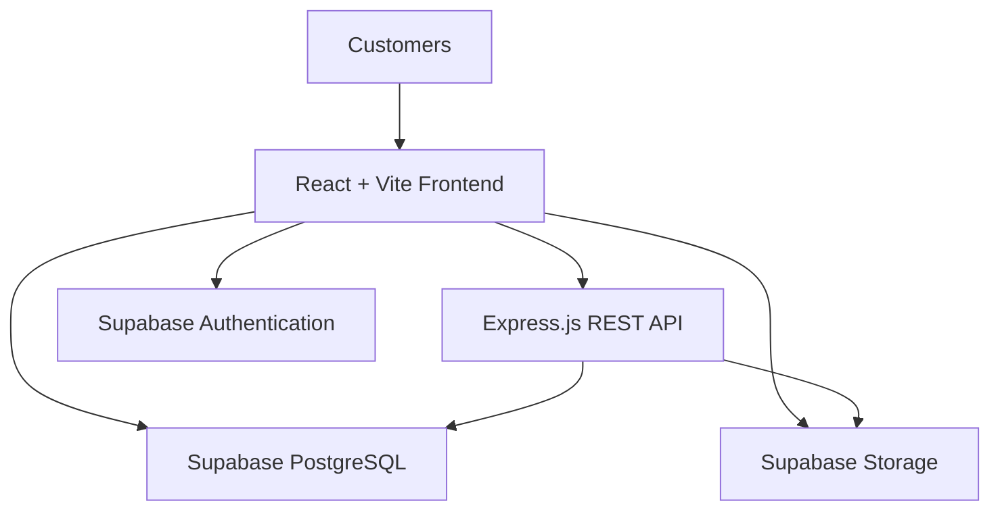

<div align="center">

# 🛍️ ShopSphere

### Discover. Shop. Enjoy.

**A modern, full-stack e-commerce platform built with React, Node.js and Supabase.**

[](https://react.dev/)
[](https://vite.dev/)
[](https://nodejs.org/)
[](https://expressjs.com/)
[](https://supabase.com/)
[](https://developer.mozilla.org/en-US/docs/Web/JavaScript)

**🚧 Active Development**

</div>

---

## ✨ About ShopSphere

ShopSphere is a full-stack e-commerce application designed to provide a modern online shopping experience.

The project focuses on building a complete e-commerce system while applying practical software development concepts, including REST API development, database management, authentication, cloud storage, application security and deployment.

The application is being developed incrementally, with an emphasis on clean architecture, reusable components and real-world development practices.

## 🚀 Key Features

| Feature | Description |
|---|---|
| 🛍️ Product Catalogue | Browse products with detailed product information. |
| 🔎 Product Discovery | Search, filter and sort products. |
| 🛒 Shopping Cart | Add, remove and manage shopping cart items. |
| 💾 Cart Persistence | Preserve cart data using browser storage. |
| 🔄 Multi-Tab Sync | Synchronise cart changes across browser tabs. |
| 📦 Stock Validation | Validate product availability before adding items. |
| 🔐 Customer Authentication | Register, verify email, sign in and sign out. |
| 👤 Customer Profiles | Retrieve and update customer profile information. |
| 🖼️ Profile Pictures | Upload and manage customer profile pictures using Supabase Storage. |
| ☁️ Cloud Image Storage | Store product images in Supabase Storage. |
| 🌗 Responsive Interface | Responsive layouts with automatic light and dark themes. |

## 🏗️ Project Architecture



### Architecture Overview

- **Frontend:** React handles the user interface, product browsing, cart and customer account experience.
- **Backend:** Express.js provides REST APIs for product operations and image uploads.
- **Database:** Supabase PostgreSQL stores product and customer profile information.
- **Authentication:** Supabase Auth manages customer registration, email verification and login sessions.
- **Storage:** Supabase Storage manages product images and customer profile pictures.

## 🧰 Technology Stack

| Layer | Technologies |
|---|---|
| Frontend | React.js, Vite, JavaScript, CSS |
| Backend | Node.js, Express.js |
| Database | Supabase PostgreSQL |
| Authentication | Supabase Auth |
| Image Storage | Supabase Storage |
| API Communication | REST APIs, Fetch API |
| Version Control | Git, GitHub |
| Development Tools | VS Code, npm, Postman |

## 📂 Project Structure

```text
ecommerce-platform/
│
├── backend/
│   ├── src/
│   │   ├── config/
│   │   │   ├── db.js
│   │   │   ├── supabase.js
│   │   │   └── testDb.js
│   │   │
│   │   ├── controllers/
│   │   │   ├── imageController.js
│   │   │   └── productController.js
│   │   │
│   │   ├── routes/
│   │   │   ├── imageRoutes.js
│   │   │   └── productRoutes.js
│   │   │
│   │   └── app.js
│   │
│   ├── server.js
│   └── package.json
│
├── frontend/
│   ├── src/
│   │   ├── components/
│   │   │   ├── Login.jsx
│   │   │   ├── Register.jsx
│   │   │   └── Profile.jsx
│   │   │
│   │   ├── config/
│   │   │   └── supabase.js
│   │   │
│   │   ├── App.jsx
│   │   ├── App.css
│   │   └── main.jsx
│   │
│   ├── .env
│   └── package.json
│
├── screenshots/
│
├── .gitignore
└── README.md
```

## ⚙️ Local Setup

### Prerequisites

- Node.js and npm
- Git
- Supabase account
- Code editor such as VS Code

### 1. Clone the repository

```bash
git clone <your-github-repository-url>
cd ecommerce-platform
```

### 2. Configure the backend

```bash
cd backend
npm install
```

Create a `.env` file inside the backend directory:

```env
PORT=5001
DATABASE_URL=your_supabase_postgresql_connection_string
SUPABASE_URL=your_supabase_project_url
SUPABASE_SECRET_KEY=your_supabase_secret_key
```

Start the backend:

```bash
node server.js
```

Backend runs at:

`http://localhost:5001`

Health check:

`http://localhost:5001/api/health`

### 3. Configure the frontend

Open another terminal:

```bash
cd frontend
npm install
```

Create a `.env` file inside the frontend directory:

```env
VITE_SUPABASE_URL=your_supabase_project_url
VITE_SUPABASE_PUBLISHABLE_KEY=your_supabase_publishable_key
```

Start the frontend:

```bash
npm run dev
```

Frontend runs at:

`http://localhost:5173`

**Important:** Never commit `.env` files or expose backend Supabase secret keys in frontend code or GitHub.

## 🔒 Security Implementation

ShopSphere incorporates security measures as features are developed:

- Supabase Authentication for customer identity management.
- PostgreSQL Row Level Security (RLS) for customer profile access.
- Storage policies restricting customers to their own profile picture folders.
- Backend environment variables for sensitive credentials.
- Image upload restrictions for file size and permitted image formats.
- Database constraints for product prices and stock quantities.

Additional production security controls will be implemented before deployment.

## 🗺️ Development Roadmap

### Phase 1 — Core E-Commerce

- [x] Project setup and architecture
- [x] Product catalogue
- [x] Product details
- [x] Search, filter and sort
- [x] Shopping cart
- [x] Cart persistence
- [x] Multi-tab cart synchronisation
- [x] Stock validation
- [x] Responsive design and light/dark themes
- [x] Customer registration and email verification
- [x] Customer login and logout
- [x] Session persistence
- [x] Customer profile management
- [x] Profile picture uploads
- [ ] Customer delivery address management
- [ ] Checkout workflow
- [ ] Payment integration
- [ ] Order management

### Phase 2 — Scale & Deployment

- [ ] Docker containerisation
- [ ] Backend deployment on Render
- [ ] Frontend deployment on Vercel
- [ ] AWS infrastructure and EC2 deployment
- [ ] GitHub Actions CI/CD
- [ ] Application monitoring and logging
- [ ] Performance and security improvements

### Phase 3 — AI-Powered Shopping

- [ ] AI-powered product recommendations
- [ ] Intelligent shopping assistant
- [ ] Gemini Vision product information extraction
- [ ] Personalised shopping experience

## 🎯 Project Objectives

ShopSphere is also a practical learning project focused on:

- Full-stack application development.
- REST API design and integration.
- Relational database design and SQL.
- Authentication and authorisation.
- Cloud storage integration.
- Git and GitHub workflows.
- Application deployment and CI/CD.
- Scalable and maintainable software architecture.

## 📌 Current Development Status

ShopSphere is actively being developed. The product catalogue, shopping cart, customer authentication, profile management and image storage capabilities have been implemented and tested locally.

Checkout, payments, deployment and AI-powered capabilities remain part of the development roadmap.

---

<div align="center">

### Built with ❤️ using modern web technologies

**ShopSphere — Discover. Shop. Enjoy.**

</div>
