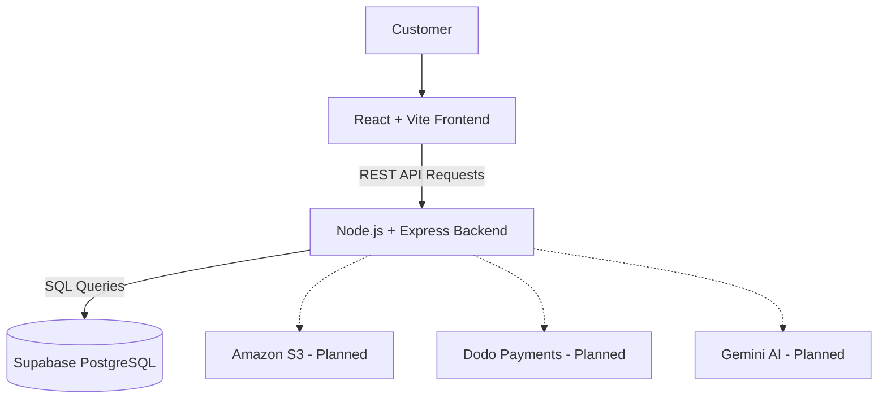

# 🛍️ ShopSphere

### Discover. Shop. Enjoy.

**A modern full-stack e-commerce platform built with React, Node.js, Express.js and Supabase PostgreSQL.**

Building a complete shopping experience through modern web technologies, scalable architecture and practical software engineering.

\<p align="center">
&#x20; \
&#x20; \
&#x20; \
&#x20; \
&#x20; \
&#x20; \
\</p>

---

## ✨ About ShopSphere

ShopSphere is a full-stack e-commerce application designed to deliver a smooth and responsive online shopping experience.

The project combines a modern React frontend with a Node.js and Express backend, supported by a Supabase PostgreSQL database.

From product discovery and shopping cart management to secure checkout, cloud deployment and AI-powered shopping assistance, ShopSphere is being developed as a practical exploration of modern full-stack engineering.

## 🛒 Product Showcase

A look at the products currently available in the ShopSphere catalogue.

| Product                | Category    |  Price |
| ---------------------- | ----------- | -----: |
| 🎧 Wireless Headphones | Electronics | ₹2,499 |
| ⌨️ Mechanical Keyboard | Electronics | ₹3,999 |
| 🎒 Travel Backpack     | Accessories | ₹1,499 |

*Product information is retrieved dynamically from Supabase PostgreSQL.*

## 🚀 Features

| Feature             | Description                              | Status |
| ------------------- | ---------------------------------------- | ------ |
| Product Catalogue   | Display products from the database       | ✅      |
| Product Search      | Search by name and description           | ✅      |
| Category Filtering  | Browse products by category              | ✅      |
| Product Sorting     | Sort by price, name and newest           | ✅      |
| Product Details     | Dedicated product information view       | ✅      |
| Shopping Cart       | Add, remove and update quantities        | ✅      |
| Cart Persistence    | Save cart using localStorage             | ✅      |
| Multi-tab Sync      | Synchronise cart between browser tabs    | ✅      |
| Stock Validation    | Verify availability through backend APIs | ✅      |
| Responsive UI       | Adapt to different screen sizes          | ✅      |
| Light/Dark Theme    | System-based theme support               | ✅      |
| Authentication      | Customer, seller and admin accounts      | 🔜     |
| Checkout & Payments | Secure order and payment processing      | 🔜     |

## 🧠 Technology Stack

**Frontend**

- React.js
- Vite
- JavaScript
- CSS

**Backend**

- Node.js
- Express.js
- RESTful APIs

**Database**

- Supabase
- PostgreSQL

**Cloud & DevOps — Planned**

- Docker
- AWS EC2
- Amazon S3
- GitHub Actions
- Vercel
- Render

**Payments & AI — Planned**

- Dodo Payments
- Gemini Vision

## 🏗️ Application Architecture



## 📂 Project Structure

```text
ecommerce-platform/
│
├── backend/
│   ├── src/
│   │   ├── config/
│   │   ├── controllers/
│   │   └── routes/
│   ├── server.js
│   └── package.json
│
├── frontend/
│   ├── src/
│   │   ├── App.jsx
│   │   ├── App.css
│   │   └── main.jsx
│   ├── public/
│   └── package.json
│
├── .gitignore
└── README.md
```

## ⚙️ Getting Started

### Prerequisites

- Node.js (LTS recommended)
- npm
- Git
- Supabase account

### 1. Clone the repository

```bash
git clone https://github.com/YOUR-USERNAME/YOUR-REPOSITORY.git
cd ecommerce-platform
```

### 2. Configure the backend

```bash
cd backend
npm install
```

Create a `.env` file inside `backend/`:

```env
PORT=5001
DATABASE_URL=your_supabase_connection_string
```

### 3. Configure the database

Create a Supabase project and execute the product table SQL in the Supabase SQL Editor.

```sql
CREATE TABLE products (
    id BIGINT GENERATED ALWAYS AS IDENTITY PRIMARY KEY,
    name VARCHAR(150) NOT NULL,
    description TEXT NOT NULL,
    price NUMERIC(10, 2) NOT NULL CHECK (price >= 0),
    category VARCHAR(100) NOT NULL,
    stock INTEGER NOT NULL DEFAULT 0 CHECK (stock >= 0),
    image_url TEXT,
    created_at TIMESTAMPTZ NOT NULL DEFAULT NOW()
);

ALTER TABLE public.products ENABLE ROW LEVEL SECURITY;
```

Add sample products and configure the backend connection.

### 4. Run the backend

```bash
npm run dev
```

Backend: `http://localhost:5001`

### 5. Run the frontend

Open another terminal:

```bash
cd frontend
npm install
npm run dev
```

Frontend: `http://localhost:5173`

## 🔌 API Endpoints

| Method | Endpoint            | Purpose                  |
| ------ | ------------------- | ------------------------ |
| GET    | `/api/health`       | Backend health check     |
| GET    | `/api/products`     | Retrieve all products    |
| GET    | `/api/products/:id` | Retrieve a product by ID |

## 🗺️ Development Roadmap

### Phase 1 — Core Commerce

- [x] Frontend and backend setup
- [x] Supabase PostgreSQL integration
- [x] Product catalogue and APIs
- [x] Search, filtering and sorting
- [x] Product details
- [x] Shopping cart
- [x] Cart persistence and synchronisation
- [x] Preliminary stock validation
- [ ] Authentication and role management
- [ ] Checkout and order management
- [ ] Payment integration
- [ ] Seller and admin dashboards

### Phase 2 — Cloud & DevOps

- [ ] Docker multi-stage builds
- [ ] Render backend deployment
- [ ] Vercel frontend deployment
- [ ] Amazon S3 image storage
- [ ] AWS EC2 deployment
- [ ] GitHub Actions CI/CD
- [ ] Monitoring and application reliability

### Phase 3 — AI-Powered Commerce

- [ ] Gemini Vision product information extraction
- [ ] AI-powered product recommendations
- [ ] Intelligent shopping assistant

## 🔐 Engineering & Security Goals

- Server-side validation of product prices and stock.
- Secure authentication and role-based access.
- Database transactions for order creation.
- Inventory concurrency protection using `SELECT ... FOR UPDATE`.
- Idempotent order and payment operations.
- Payment webhook signature verification.
- Environment variable and secret protection.
- API validation, rate limiting and CORS configuration.

## 💡 Project Vision

ShopSphere is more than a basic shopping application. It is an evolving full-stack engineering project exploring the complete software development lifecycle — from frontend development and database integration to cloud infrastructure, DevOps automation and AI-powered features.

**Built with curiosity. Engineered for scale. Designed for what's next.**

---

\<p align="center">
&#x20; \<b>ShopSphere\</b>\<br/>
&#x20; Full-Stack Development • Cloud Engineering • AI Innovation
\</p>
